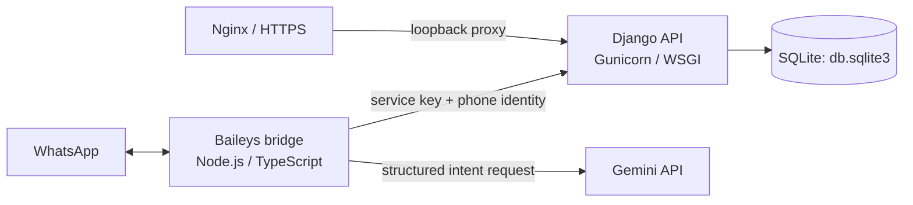

# FD deployment and operations guide

This guide describes the repository as it exists today and a careful Ubuntu 24.04 deployment for one FD instance. The repository contains no production VPS configuration, domain, public IP, existing Nginx site, or service units. Replace the marked values after inspecting the server. The examples use a private loopback backend and systemd; verify that this fits the host's existing process and Nginx layout before enabling anything.

## Architecture and verified project facts



Django owns profiles, user-scoped transaction writes, idempotency records, pending actions, and exact summary calculations. The bridge runs continuously, owns the single Baileys socket for its session directory, interprets natural language, and calls Django over HTTP. Gemini is used by the bridge through the Google Generative Language REST API with `fetch`; this repository does not install a Gemini SDK. Nginx should expose only the Django web/API route. The bridge makes outbound connections to WhatsApp and Gemini and needs no public listener.

Verified local configuration: Django 6.1.2, Python requirements in `requirements.txt`, Node/TypeScript service under `whatsapp-service/`, Baileys resolved as 6.7.24 in the lockfile, and SQLite at `<project-root>/db.sqlite3`. Django currently hard-codes SQLite and `TIME_ZONE=UTC`; user country preferences supply the date zone (Uganda is configured as `Africa/Kampala`). No Gunicorn, Docker Compose, production database configuration, `STATIC_ROOT`, domain, or Nginx configuration is present in this repository. Production setup below therefore requires operator verification and adds Gunicorn to the deployment virtual environment; it does not claim the VPS was inspected or tested.

## Prerequisites and secrets

- Ubuntu 24.04 VPS, SSH access, a non-root deployment account, Python 3.12 compatible with the repository's Django 6.1.2, Node.js 20 or later, and Nginx already managed by the server operator.
- A domain and TLS certificate already selected for this app, with the Nginx configuration path and reload procedure confirmed on the host.
- Outbound HTTPS access to the Gemini and WhatsApp services.
- A protected copy of the existing SQLite database and WhatsApp session before production setup or upgrades.

Choose an application directory (shown as `/opt/fd`), service user (`fd`), virtual environment (`/opt/fd/.venv`), and an unused loopback port (shown as `127.0.0.1:8017`). Check each value against the VPS before using it. Do not use root to run either process.

Create `/opt/fd/.env` from `.env.example`, then supply strong, unique production values. Keep it readable only by the service account and administrators:

```dotenv
DJANGO_SECRET_KEY=replace_with_a_unique_secret
DJANGO_DEBUG=False
DJANGO_ALLOWED_HOSTS=fd.example.com
DJANGO_SERVICE_KEY=replace_with_a_long_random_secret
DJANGO_BASE_URL=http://127.0.0.1:8017
GEMINI_API_KEY=replace_with_your_key
GEMINI_MODEL=gemini-3.5-flash
```

Use the same service key for Django and the bridge (both read this root file). Never put real credentials in Git, service unit contents, command-line arguments, or this guide. The local `.env` must not be copied to production. Check configuration without printing values:

```bash
cd /opt/fd
.venv/bin/python - <<'PY'
from pathlib import Path
keys = {line.split('=', 1)[0].strip() for line in Path('.env').read_text().splitlines() if '=' in line and not line.lstrip().startswith('#')}
required = {'DJANGO_SECRET_KEY','DJANGO_DEBUG','DJANGO_ALLOWED_HOSTS','DJANGO_SERVICE_KEY','DJANGO_BASE_URL','GEMINI_API_KEY','GEMINI_MODEL'}
print('Missing:', ', '.join(sorted(required - keys)) or 'none')
PY
```

The bridge's `npm run gemini:models` lists models available to its configured key, and `npm run gemini:test` makes a minimal real structured request. These commands do not print the key. Run them only after the bridge build and outbound network are available; model listing alone does not prove generation works.

## Prepare the application

Inspect the current server first: user/group ownership, free disk, installed Python and Node versions, Nginx sites and upstream ports, firewall, and any existing services using the proposed directory, port, or domain. Do not replace a shared Nginx configuration or start another bridge on the same WhatsApp session.

As an administrator, create the service account and application directory using the host's established policy. Place a reviewed source checkout at `/opt/fd`, then as the service account:

```bash
cd /opt/fd
python3 -m venv .venv
.venv/bin/python -m pip install --upgrade pip
.venv/bin/pip install -r requirements.txt
.venv/bin/pip install gunicorn
cd whatsapp-service
npm ci
npm run build
```

Gunicorn is an additional production process server, not a current project dependency. Pin it in the deployment's dependency management before treating this as a repeatable release. The bridge's package lock pins the resolved dependency graph; use `npm ci`, not `npm install`, for deployments.

Copy the current valid `whatsapp-service/whatsapp-session/` directory only through an encrypted, access-controlled transfer, if an existing account is intended for production. Preserve all files and restrictive permissions. Do not pair a second bridge with the same WhatsApp account/session. Do not delete or regenerate session data as routine troubleshooting.

## Database backup, migrations, and static files

The checked-in Django settings use SQLite at `/opt/fd/db.sqlite3`; no `DATABASE_URL` or PostgreSQL production setting exists. Confirm that this is the intended production database before proceeding. Keep the database and its parent directory writable by `fd`; never serve the database over HTTP.

Before the first migration and every schema upgrade, make a timestamped SQLite-consistent backup. The SQLite CLI's `.backup` operation can copy a live database consistently:

```bash
install -d -m 700 /opt/fd/backups
sqlite3 /opt/fd/db.sqlite3 ".backup '/opt/fd/backups/fd-$(date -u +%Y%m%dT%H%M%SZ).sqlite3'"
chmod 600 /opt/fd/backups/*.sqlite3
```

On the initial installation, if there is no production database, run:

```bash
cd /opt/fd
.venv/bin/python manage.py check --deploy
.venv/bin/python manage.py showmigrations
.venv/bin/python manage.py migrate --plan
.venv/bin/python manage.py migrate
.venv/bin/python manage.py showmigrations
```

Do not use `flush`, delete the database, or fake migrations to make deployment pass. Preserve the existing database when upgrading. Review the migration plan and backup before applying schema changes. Current repository migrations add profile country/currency settings, transaction categories/void audit fields, pending actions, and deletion confirmation; local migration status does not prove production status.

The settings do not define `STATIC_ROOT` or configure a static collection directory. Django admin static files therefore need an explicit production static-file setting before enabling `collectstatic`, or a separately verified static-files strategy. Do not run `collectstatic` expecting it to populate an unspecified directory. Add a `STATIC_ROOT` appropriate to the host and test it before proxying Django admin.

To validate a backup, restore it to a new temporary path (never over the live database) and open/check that copy with `sqlite3`. If rollback is necessary after a migration, stop FD, preserve the current DB separately, and restore the pre-migration copy only after deciding how to handle writes made since the backup. Restoring a database loses later writes, so coordinate that operation with the owner.

## Django service with systemd

The repository does not currently ship a production WSGI server or a systemd unit. After installing and pinning Gunicorn, create `/etc/systemd/system/fd-django.service` with the verified deployment values:

```ini
[Unit]
Description=FD Django API
After=network.target

[Service]
Type=simple
User=fd
Group=fd
WorkingDirectory=/opt/fd
EnvironmentFile=/opt/fd/.env
ExecStart=/opt/fd/.venv/bin/gunicorn config.wsgi:application --bind 127.0.0.1:8017 --workers 2 --timeout 60
Restart=on-failure
RestartSec=5
UMask=0077
NoNewPrivileges=true
PrivateTmp=true

[Install]
WantedBy=multi-user.target
```

Verify the user, paths, port, database ownership, and environment file before enabling. Bind Gunicorn to loopback only. The worker count is an initial low-volume example; SQLite supports limited concurrent writes, so review capacity before increasing it.

```bash
sudo systemd-analyze verify /etc/systemd/system/fd-django.service
sudo systemctl daemon-reload
sudo systemctl enable --now fd-django.service
sudo systemctl status fd-django.service --no-pager
sudo journalctl -u fd-django.service -n 100 --no-pager
curl --fail http://127.0.0.1:8017/api/v1/health/
```

`systemctl enable` starts Django after VPS reboot. `manage.py migrate` and `collectstatic` (once configured) are deployment commands and exit; Gunicorn is the persistent Django process.

## WhatsApp bridge service with systemd

The bridge package scripts are `npm run build` and `npm start`; `npm start` runs `node dist/index.js`. The bridge reads `/opt/fd/.env`, reaches Django via `DJANGO_BASE_URL`, and uses `whatsapp-service/whatsapp-session/`. It takes an exclusive process lock for that session directory. Use exactly one active service instance for the session.

Create `/etc/systemd/system/fd-whatsapp.service` after confirming Node's executable path with `command -v node`:

```ini
[Unit]
Description=FD WhatsApp bridge
Wants=network-online.target fd-django.service
After=network-online.target fd-django.service

[Service]
Type=simple
User=fd
Group=fd
WorkingDirectory=/opt/fd/whatsapp-service
EnvironmentFile=/opt/fd/.env
ExecStart=/usr/bin/node /opt/fd/whatsapp-service/dist/index.js
Restart=on-failure
RestartSec=10
UMask=0077
NoNewPrivileges=true
PrivateTmp=true

[Install]
WantedBy=multi-user.target
```

The bridge also performs a bounded reconnect lifecycle for WhatsApp and a one-time Django health check. Review the current Baileys behavior in [version1.md](version1.md) before interpreting connection errors. A stopped/failed bridge is not repaired by deleting credentials. On a 440 conflict, check for another process or linked session; on a logged-out state, follow the approved WhatsApp relinking process while preserving a backup of the old session.

```bash
sudo systemd-analyze verify /etc/systemd/system/fd-whatsapp.service
sudo systemctl daemon-reload
sudo systemctl enable --now fd-whatsapp.service
sudo systemctl status fd-whatsapp.service --no-pager
sudo journalctl -u fd-whatsapp.service -f
```

After a reboot, systemd starts one bridge process. Its in-process lock is an additional guard against a duplicate, not a substitute for checking host-level duplicate units or manually started processes.

## Nginx, TLS, and network exposure

No domain, public IP, TLS path, existing site, or production Nginx file is present here. Inspect the live server and its existing Nginx layout; do not replace a shared/default site or reload Nginx before validating the full configuration. A site-specific upstream should proxy the verified domain to `http://127.0.0.1:8017`, forward the original `Host`, client address, and HTTPS scheme, and enforce HTTPS using the host's established certificate automation. Keep Django and bridge ports private; expose only SSH and the existing public web ports. Do not open port 8017 or a WhatsApp bridge listener publicly.

Set `DJANGO_ALLOWED_HOSTS` to the exact production host(s). If the deployment terminates TLS at Nginx, configure trusted proxy HTTPS handling and CSRF trusted origins in Django before using browser login/admin over HTTPS; these settings are not currently present. Review `manage.py check --deploy`, TLS renewal, firewall rules, and the full Nginx configuration. Run `sudo nginx -t` before any approved reload. Preserve other sites and applications on the VPS.

## Verification, logs, and common recovery

After deployment or reboot:

```bash
sudo systemctl is-active fd-django.service fd-whatsapp.service
curl --fail http://127.0.0.1:8017/api/v1/health/
cd /opt/fd
.venv/bin/python manage.py check --deploy
.venv/bin/python manage.py showmigrations
cd /opt/fd/whatsapp-service
npm run gemini:models
npm run gemini:test
```

`/api/v1/health/` checks Django only. Confirm bridge connection from its journal logs and an approved test account; a real WhatsApp test was not performed as part of writing this guide. Check `sudo nginx -t` and the site's HTTPS endpoint after the app-specific proxy is installed. Review logs without enabling message-body or credential logging.

- Django 400/401/403 from the bridge: inspect the service key configuration without printing it, sender onboarding, and user identity resolution.
- SQLite permission or locked errors: check the database and directory owner, free disk, backup activity, and concurrent Django writers. Do not delete the live database.
- Gemini model-list works but generation fails: verify that the selected model supports `generateContent`, account quota/API access, and the bridge's structured-request response. `gemini:models` alone is not a generation test.
- WhatsApp is disconnected: inspect the sanitized bridge journal and make sure no second bridge owns the session. Preserve session data and use WhatsApp's normal device relinking procedure only when required.
- Nginx fails validation: leave the running configuration unchanged, correct only the app-specific site file, and validate the complete config before an operator-approved reload.

## Safe updates and rollback

1. Stage and review the release; do not deploy unreviewed source or `.env` changes.
2. Back up SQLite and the WhatsApp session to protected storage before schema or runtime changes.
3. Build the bridge (`npm ci`, `npm run build`) and run the automated suites in an isolated deployment/staging copy.
4. Stop the bridge briefly before replacing its code so no second Baileys socket starts. If users are actively messaging, schedule a maintenance window. Stop Django only if the database or deployment procedure requires it.
5. Apply reviewed migrations, then restart Django and the bridge once. Check service logs and health before announcing completion.
6. If application code fails, restore the previous code and dependencies while preserving the current database and WhatsApp session. Restore a database backup only with a deliberate data-loss decision and a copy of the current DB retained.

Deployment and schema commands run once per release; systemd supervises the Django and WhatsApp processes continuously and starts them after reboot. The Nginx service remains shared infrastructure and is changed only through the host's reviewed site-specific process.

## Operator-supplied production values

Before production go-live, confirm the app directory, Unix account, Python/Node/Gunicorn versions and pin, actual DB path and backup destination, domain and TLS method, existing Nginx include path, upstream port, Django proxy/security settings, Gemini model/API access, firewall, and the correct WhatsApp session/account. No production server state or deployment success is asserted by this local repository guide.
